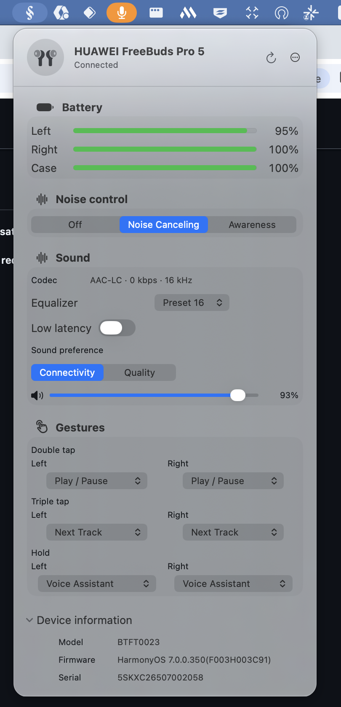

# BudsBar

**A native macOS menu-bar control panel for HUAWEI FreeBuds earbuds.**

BudsBar talks directly to your earbuds over the Bluetooth control channel — no
account, no cloud service, no vendor app. It shows battery levels and lets you
switch noise control, sound presets, and touch gestures from the menu bar.

[](LICENSE)

The compact menu-bar panel uses native macOS pickers, switches, sliders and
grouped controls, following the system appearance in light and dark mode.

## Screenshots

HUAWEI FreeBuds Pro 5 connected on macOS 27.2, with the custom menu-bar
monogram, native controls and expanded device information:



The menu-bar monogram is a transparent template image. macOS supplies its
foreground color for the current appearance.


[Download the transparent icon](Sources/BudsBar/Resources/MenuBarMonogram.png)

---

## What it does

| Feature | Notes |
|---|---|
| **Battery** | Left earbud, right earbud and case, with charging indicators |
| **Noise control** | Off and Noise cancelling validated on Pro 5; Awareness depends on the model |
| **Codec** | The codec and bitrate macOS negotiated with the earbuds, plus the sample rate |
| **Sound** | Equalizer preset, low-latency mode, sound-quality preference |
| **Volume** | Output volume for the earbuds, driven through the macOS audio stack |
| **Gestures** | Double tap, triple tap and hold — separately per earbud |
| **Device info** | Model code, firmware, serial numbers |

Every setting is **read back from the earbuds** before it is reported as
applied, so the panel never shows a value the device did not accept. When a
change is refused, the panel says so instead of failing silently.

### The codec line

The earbuds never report their codec — macOS negotiates it with the Bluetooth
controller and keeps the result to itself. The system does write the outcome
into its log, so BudsBar asks the system for the controller information
(`system_profiler`, which answers in a tenth of a second) and reads the line
back. The sample rate comes from CoreAudio, which describes the stream macOS
actually plays.

The result looks like `AAC-LC · 192 kbps · 44.1 kHz`.

The codec is read-only on macOS: which codec is used is a decision of the
operating system, not of the earbuds. The **Sound quality** control below it
is the earbuds' own preference and does change what they do.

## Requirements

- macOS 27.2 or later
- Full Xcode 27.2 or later, selected with `xcode-select`
- The earbuds paired with your Mac

## Install

### From source

```sh
git clone git@github.com:felipecastro009/budsbar.git
cd budsbar
./scripts/build-app.sh
./scripts/install.sh
```

`install.sh` copies the app to `/Applications` and launches it. The first
launch asks for Bluetooth permission.

> macOS ties that permission to the signature of the binary. Every new build
> is a new signature, so a locally built app asks again — approve the prompt
> and the panel connects.

### Launch or restart the local build

```sh
open build/BudsBar.app
```

A monogram appears in the macOS menu bar. Click it to open the panel; the app
has no Dock icon or standalone main window. Without a connection, the panel
shows an empty state and hides device readings and controls. If an older
instance is already running, quit BudsBar from its options menu before
opening the new build.

Homebrew instructions from upstream install the upstream release, not this
fork. Build from source for the changes documented here.

## Build from source

The project is a plain Swift Package Manager package — no `.xcodeproj` needed.

```sh
swift build -c release          # build
./scripts/test.sh               # run the protocol tests
./scripts/build-app.sh          # assemble and sign the .app bundle
```

Builds and tests use the macOS 27.2 SDK from the selected toolchain.
Full Xcode is required for the SwiftUI macro plugins; standalone Command
Line Tools can build the headless probe but cannot build the interface.
Override the SDK with `BUDSBAR_SDK=/path/to/SDK` when necessary.

Run `./scripts/test.sh` for the protocol tests. Extra `swift test` arguments
can be passed to the script. Tests and apps require macOS 27.2 or later.

CI selects Xcode 27.2 on the `xcode-27` runner image. That image currently
lists macOS 27.0.1, so the test step explicitly fails its runtime check until
the runner OS reaches 27.2. Local testing on macOS 27.2+ is required in the
meantime; a successful cross-build alone does not verify the tests.

## Diagnostics

Read-only diagnostics succeeded on FreeBuds Pro 5 (model `BTFT0023`) with
HarmonyOS `7.0.0.350(F003H003C91)` on macOS 27.2. The probe received identity,
battery, noise mode, equalizer options, latency, sound quality, wear detection,
dual connection and gesture settings. The write diagnostic also changed,
read back and restored all five settings below:

1. Noise mode: cancellation → off → cancellation.
2. Equalizer: preset 16 → preset 2 → preset 16.
3. Low latency: false → true → false.
4. Sound preference: connectivity → quality → connectivity.
5. Right double tap: play/pause → previous track → play/pause.

These checks validate protocol read-back and restoration. Audio stability,
automatic switching between devices and coexistence with the Huawei app
remain under investigation. The local suite passed 29 tests with Xcode 27.2.

Equalizer and gesture identifiers without confirmed names retain numeric labels.
The reported noise `level` is not proof of cancellation strength.
To check compatibility, pair and connect the earbuds to the Mac, then run the
read-only diagnostic as an app from Terminal:

```sh
./scripts/build-probe.sh
open -W --stdout /tmp/budsprobe.log --stderr /tmp/budsprobe.log build/BudsProbe.app
cat /tmp/budsprobe.log
```

The probe builds with the macOS 27.2 SDK and does not
depend on SwiftUI. Override the SDK with `BUDSBAR_SDK=/path/to/SDK` if needed.
Launching the app through `open` gives the diagnostic its own bundle identity
for Bluetooth permissions. Run without `--write` or `--set`
to avoid changing earbud settings. Check the reported model code, firmware,
battery and feature values; unknown values do not establish support.
The diagnostic also prints device serial numbers, so redact them before
sharing output. A successful protocol test suite does not verify a device.

The probe includes its own Bluetooth usage description. Allow Bluetooth access
when macOS requests it. If access was denied, check System Settings > Privacy
& Security > Bluetooth for the probe or the terminal used to launch it.

A headless probe that exercises the same protocol code as the app:

```sh
swift run BudsProbe            # read everything
swift run BudsProbe --write    # also round-trip one write per feature
```

To validate setting changes using the app bundle:

```sh
./scripts/build-probe.sh
open -W --stdout /tmp/budsprobe-write.log --stderr /tmp/budsprobe-write.log build/BudsProbe.app --args --write
cat /tmp/budsprobe-write.log
```

The probe changes and restores noise mode, equalizer, low latency, sound
quality preference and the right double-tap action, when readable values
and alternate options are available. It stops with `VALIDATION FAILED` and
exit code 2 if a change or restoration cannot be confirmed. A successful
run prints `VALIDATION PASSED` with the number of settings checked. The
launcher exiting successfully alone does not establish validation success.

## How it works

```
BudsBar.app
├── MenuBarExtra (.window)  →  the control panel
├── BudsCore
│   ├── WireFormat.swift    →  frame encode / decode, CRC-16/XMODEM
│   ├── Commands.swift      →  command catalogue
│   ├── RFCommLink.swift    →  Bluetooth RFCOMM transport
│   ├── DeviceController.swift →  state machine, read-back verification
│   ├── AudioCodec.swift    →  codec and bitrate from the system log
│   └── OutputVolume.swift  →  CoreAudio output volume
├── BudsUI
│   ├── ControlPanel.swift  →  panel shell and header
│   ├── PanelContent.swift  →  the control sections
│   ├── Controls.swift      →  native pickers, switches and battery rows
│   └── EarbudIcon.swift    →  the original earbud illustration
└── BudsProbe               →  headless diagnostic
```

The earbuds expose a classic Bluetooth **Serial Port (SPP)** service on
RFCOMM channel 1. Frames are sent as:

```
0x5A | length (2, big-endian) | 0x00 | command (2, big-endian) | TLV… | CRC-16/XMODEM (2)
```

`length` counts the command body plus one. The CRC covers everything from the
magic byte to the end of the body and is verified on every received frame.

## Supported devices

Originally verified on **HUAWEI FreeBuds 6** (model `BTFT0020`, firmware
`HarmonyOS 6.1.0.358`, macOS 26.x, Apple Silicon).
This fork now requires macOS 27.2+. **HUAWEI FreeBuds Pro 5** (`BTFT0023`)
with HarmonyOS `7.0.0.350(F003H003C91)` passed read diagnostics and five
write/read-back/restore checks, as detailed above. This does not establish
support for every feature or firmware version.

The protocol is shared across the FreeBuds line and the app is written to
adapt to what the device reports — equalizer presets and gesture actions are
driven by values the earbuds themselves advertise. The one exception is the
set of noise-control options: the device does not advertise them and accepts
values its hardware does not implement, so those come from a small table
keyed by model code. The FreeBuds 6, for example, offers noise cancelling
without a transparency mode.

Other models are untested; the app will show what it can read and leave the
rest unknown.

## Project layout

```
Sources/
├── BudsCore/       protocol, transport, state model
├── BudsUI/         native SwiftUI panel and controls
├── BudsBar/        the menu-bar app and bundled PNG icon
├── BudsProbe/      headless diagnostic
└── BudsPanelShot/  renders the panel to PNG for the docs
Tests/              protocol unit tests
Tools/              icon generator, accessibility inspector
scripts/            build, install, render
docs/               protocol notes, motion notes, design notes
```

## Legal

BudsBar is an independent project. It is **not affiliated with, endorsed by,
or sponsored by Huawei or Honor**. This fork is based on
[Egorich-print/budsbar](https://github.com/Egorich-print/budsbar). The protocol
details are interoperability information; the implementation is original code.

Released under the [MIT License](LICENSE).
