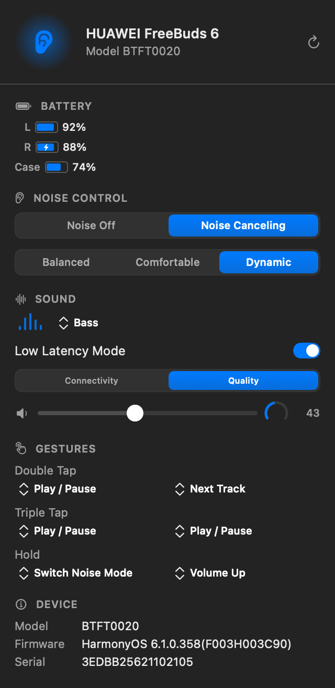
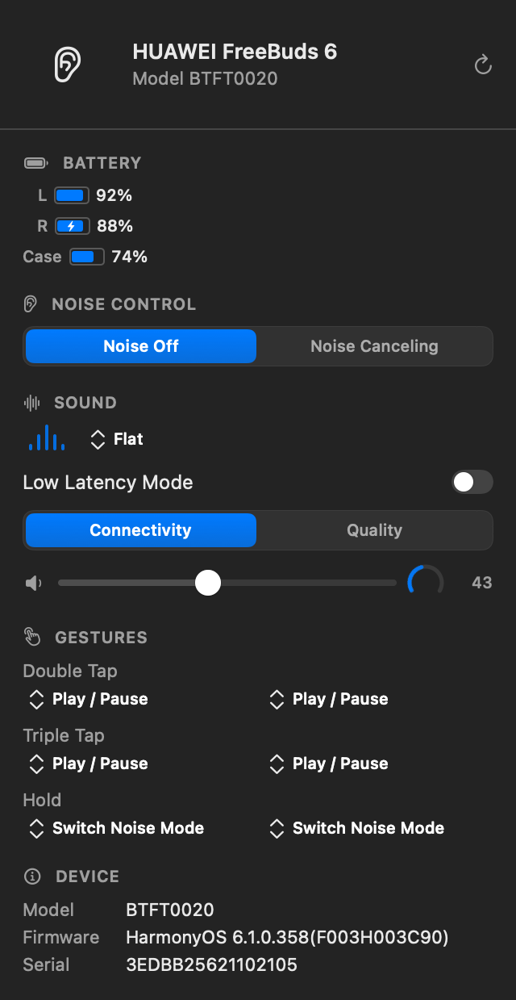

# BudsBar

**A native macOS menu-bar control panel for HUAWEI FreeBuds earbuds.**

BudsBar talks directly to your earbuds over the Bluetooth control channel — no
account, no cloud service, no vendor app. It shows battery levels and lets you
switch noise control, sound presets, and touch gestures from the menu bar.

[](LICENSE)



---

## What it does

| Feature | Notes |
|---|---|
| **Battery** | Left earbud, right earbud and case, with charging indicators |
| **Noise control** | Off / Noise cancelling / Awareness — only the modes the model really offers |
| **Sound** | Equalizer preset, low-latency mode, sound-quality preference |
| **Volume** | Output volume for the earbuds, driven through the macOS audio stack |
| **Gestures** | Double tap, triple tap and hold — separately per earbud |
| **Device info** | Model code, firmware, serial numbers |

Every setting is **read back from the earbuds** before it is reported as
applied, so the panel never shows a value the device did not accept. When a
change is refused, the panel says so instead of failing silently.

| Connected | Noise cancelling |
|---|---|
|  |  |

## Requirements

- macOS 14 or later
- Swift 6 toolchain (Xcode 16+ or the Command Line Tools)
- The earbuds paired with your Mac

## Install

### From source

```sh
git clone https://github.com/Egorich-print/budsbar.git
cd budsbar
./scripts/build-app.sh
./scripts/install.sh
```

`install.sh` copies the app to `/Applications` and launches it. The first
launch asks for Bluetooth permission.

### Homebrew

```sh
brew install --cask budsbar
```

## Build from source without Xcode

The project is a plain Swift Package Manager package — no `.xcodeproj` needed.

```sh
swift build -c release          # build
swift test                      # run the protocol tests
./scripts/build-app.sh          # assemble and sign the .app bundle
```

> **Note on SDKs.** The build targets the macOS 26.5 SDK by default because
> newer SDKs turn SwiftUI's `@State` into a macro whose implementation plugin
> ships only with the full Xcode. Override with `BUDSBAR_SDK=/path/to/SDK`.

## Diagnostics

A headless probe that exercises the same protocol code as the app:

```sh
swift run BudsProbe            # read everything
swift run BudsProbe --write    # also round-trip one write per feature
```

## How it works

```
BudsBar.app
├── MenuBarExtra (.window)  →  the control panel
├── BudsCore
│   ├── WireFormat.swift    →  frame encode / decode, CRC-16/XMODEM
│   ├── Commands.swift      →  command catalogue
│   ├── RFCommLink.swift    →  Bluetooth RFCOMM transport
│   ├── DeviceController.swift →  state machine, read-back verification
│   └── OutputVolume.swift  →  CoreAudio output volume
├── BudsUI
│   ├── ControlPanel.swift  →  panel shell and header
│   ├── PanelContent.swift  →  the control sections
│   ├── Controls.swift      →  hand-drawn segmented controls, menus, switch
│   └── Motion.swift        →  the original motion design
└── BudsProbe               →  headless diagnostic
```

The earbuds expose a classic Bluetooth **Serial Port (SPP)** service on
RFCOMM channel 1. Frames are sent as:

```
0x5A | length (2, big-endian) | 0x00 | command (2, big-endian) | TLV… | CRC-16/XMODEM (2)
```

`length` counts the command body plus one. The CRC covers everything from the
magic byte to the end of the body and is verified on every received frame.

## Supported devices

Verified on **HUAWEI FreeBuds 6** (model `BTFT0020`, firmware
`HarmonyOS 6.1.0.358`, macOS 26.x, Apple Silicon).

The protocol is shared across the FreeBuds line and the app is written to
adapt to what the device reports — equalizer presets and gesture actions are
driven by values the earbuds themselves advertise. The one exception is the
set of noise-control options: the device does not advertise them and accepts
values its hardware does not implement, so those come from a small table
keyed by model code. The FreeBuds 6, for example, offers noise cancelling
without a transparency mode.

Other models are untested; the app will show what it can read and leave the
rest unknown.

## Project layout

```
Sources/
├── BudsCore/       protocol, transport, state model
├── BudsUI/         SwiftUI panel, controls and motion design
├── BudsBar/        the menu-bar app
├── BudsProbe/      headless diagnostic
└── BudsPanelShot/  renders the panel to PNG for the docs
Tests/              protocol unit tests
Tools/              icon generator, accessibility inspector
scripts/            build, install, render
docs/               protocol notes, motion notes, design notes
```

## Legal

BudsBar is an independent project. It is **not affiliated with, endorsed by,
or sponsored by Huawei or Honor**. All artwork and motion in this project are
original. The protocol details are interoperability information; the
implementation is original code.

Released under the [MIT License](LICENSE).
